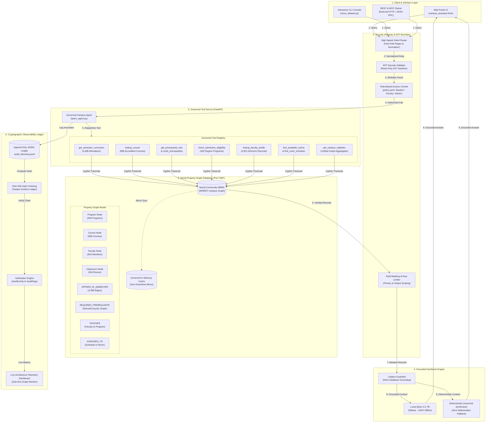

# Complete SRMIST Campus Knowledge Tool Server Architecture

This document contains the complete system architecture diagram ready to paste into **Excalidraw** or **Mermaid Live**.

---

## 1. Complete Architecture Diagram (Mermaid Code)

