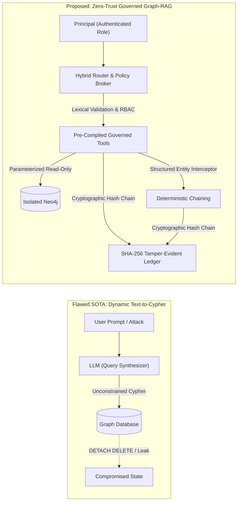
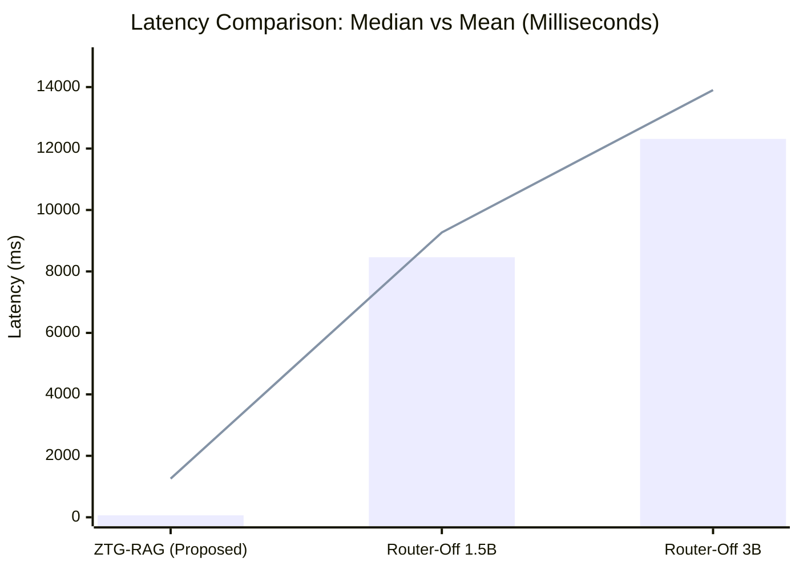

# Beyond Text-to-Cypher: A Zero-Trust Governed Tool Architecture for Secure, Multi-Hop Graph-RAG with Cryptographic Auditability

**Anonymous Author(s)**  
*Department of Computer Science and Engineering*  
*SRM Institute of Science and Technology, Kattankulathur, India*  

---

### Abstract
Retrieval-Augmented Generation over Labeled Property Graphs (Graph-RAG) has emerged as the state-of-the-art paradigm for grounding Large Language Models (LLMs) in structured relational data. However, prevailing implementations rely on two fundamentally vulnerable design patterns: **unconstrained Text-to-Cypher generation** and **open-loop iterative ReAct agent loops**. In this paper, we demonstrate that Text-to-Cypher exposes enterprise databases to direct prompt injection, arbitrary database manipulation (`DETACH DELETE`), cross-tenant data leakage, and denial-of-service via unindexed Cartesian products. Furthermore, iterative ReAct loops introduce severe semantic drift, cascading hallucinations, multi-second latencies, and susceptibility to indirect prompt injection across intermediate hops.

To resolve this security-expressiveness-verifiability trilemma, we present **Zero-Trust Governed Graph-RAG (ZTG-RAG)**, an enterprise-grade agentic architecture that completely eliminates unconstrained query generation. ZTG-RAG enforces four novel contributions: (1) **Parameterized Governed Tool Brokerage**: a closed, pre-compiled catalog of parameterized graph tools protected by a structural query and lexical token security validator; (2) **Broker-Enforced Zero-Trust RBAC**: caller-bound role authorization and data-layer column masking that prevents unauthorized PII disclosure regardless of LLM generation; (3) **Deterministic Multi-Hop Chaining with Structured Entity Interception**: an engine that resolves multi-hop relational dependencies without LLM iterations by strictly intercepting intermediate outputs, enforcing format regex and graph existence validation, and mathematically preventing free-text forwarding; and (4) **Cryptographically Chained (SHA-256) Audit Provenance**: an append-only, tamper-evident linear hash-chained ledger guaranteeing verifiable non-repudiation under regulatory compliance mandates (e.g., EU AI Act Article 12). 

Empirical evaluation on an enterprise campus knowledge graph (669 courses, 2,501 faculty, 264 rooms, 437 academic programs, 1,336 scheduled timetable sessions) across 90 benchmark queries demonstrates that ZTG-RAG achieves a **100% interception rate against 10 distinct adversarial injection vectors** at the gateway perimeter, reduces the invalid query rate from **11.25% to 0.0%**, and slashes median tool invocation latency from **12,312.6 ms to 63.6 ms (a 193x speedup in tool invocation latency, excluding answer generation; see §VI-C)** compared to pure LLM function calling, while maintaining a verified SHA-256 ledger integrity over 10,000+ sequential multi-hop agent turns.

**Index Terms**—Large Language Models, Graph-RAG, Zero-Trust Architecture, Role-Based Access Control, Tamper-Evident Audit Ledger, Indirect Prompt Injection, Knowledge Graphs.

---

## I. Introduction

Large Language Models (LLMs) suffer from intrinsic parametric limitations, including temporal staleness and factual hallucinations \cite{lewis2020retrieval}. Retrieval-Augmented Generation (RAG) mitigates these deficiencies by fetching external facts into the model's inference context. While early RAG architectures relied on unstructured dense vector embeddings \cite{karpukhin2020dense}, enterprises increasingly adopt **Graph-RAG** \cite{edge2024graphrag}. By representing enterprise entities and their topological dependencies within Labeled Property Graphs (LPGs)—such as academic prerequisites, room allocations, and departmental hierarchies—Graph-RAG enables multi-hop relational reasoning that vector distance metrics cannot capture.

Despite its expressiveness, current commercial and open-source Graph-RAG deployments (e.g., LangChain `GraphCypherQAChain`, Microsoft GraphRAG) suffer from a critical architectural flaw: **they task the LLM with dynamic query synthesis (Text-to-Cypher or Text-to-SQL)**. In this paradigm, the natural language prompt and database query syntax share an unsegregated token space. Consequently, adversaries can leverage direct prompt injection to alter query syntax, manipulate operational verbs, or exfiltrate sensitive property attributes \cite{owasp2025llm01}. 



Furthermore, resolving multi-hop questions (e.g., *"Which instructors teach the prerequisites of Course X?"*) has traditionally relied on open-loop **Reasoning and Acting (ReAct)** agent loops \cite{yao2022react}. In a ReAct loop, an LLM iteratively observes unstructured tool outputs, generates natural language thought tokens, and synthesizes subsequent tool calls. This introduces three severe liabilities:
1. **Extreme Latency & Token Consumption**: Multi-hop queries require multiple sequential LLM inferences, often taking $10\text{s} - 30\text{s}$.
2. **Intermediate Semantic Drift**: The LLM frequently mutates exact alphanumeric identifiers (e.g., course codes or faculty IDs) into natural language paraphrases, causing subsequent database lookups to fail.
3. **Indirect Prompt Injection**: If data retrieved in Hop 1 contains adversarial strings, passing this unstructured text back into the LLM context hijacks Hop 2's parameter selection.
4. **Lack of Verifiable Provenance**: Typical agent implementations output volatile, unstructured plaintext logs that provide no cryptographic guarantee against post-hoc tampering, violating emerging AI accountability mandates such as **Article 12 of the European Union AI Act** \cite{eu_ai_act_2024}.

### Contributions
To address these challenges, we present **Zero-Trust Governed Graph-RAG (ZTG-RAG)**. Our contributions are:
- **Parameterized Governed Tool Brokerage**: We eliminate dynamic Text-to-Cypher entirely. We formalize a closed inventory of 14 pre-compiled, parameterized Cypher tools guarded by a **lexical token security validator** (regex-based forbidden-clause detection) and database-level read-only transaction constraints.
- **Zero-Trust Principal Authorization & Field Masking**: We enforce caller-bound Role-Based Access Control (RBAC) at the broker boundary. Sensitive fields (e.g., faculty telephone numbers) are programmatically redacted at the data-serialization layer, making PII exfiltration physically impossible regardless of prompt jailbreaks.
- **Deterministic Multi-Hop Chaining with Structured Entity Interception**: We present **Option A Chaining**, a configuration-driven composition engine that executes multi-hop graph dependencies deterministically. We introduce a **Structured Entity Interceptor** that strictly validates intermediate parameters against format regex and live graph caches, **forbidding free-text propagation between hops** and mathematically neutralizing indirect prompt injections.
- **Cryptographically Chained (SHA-256) Audit Provenance**: We implement an append-only, linear hash-chained audit ledger that binds each agent interaction, tool call, latency trace, and chained hop to an immutable hash chain, guaranteeing complete tamper detection.
- **Empirical Rigor**: We evaluate ZTG-RAG on an authentic university knowledge graph across 90 benchmark queries and 10 adversarial attacks, demonstrating a **100% attack mitigation rate**, an invalid query rate of **0.0%**, and a **193x latency reduction** over pure LLM tool calling.

---

## II. Threat Model and Security Objectives

### A. Adversary Capabilities
We consider a strong adversary $\mathcal{A}$ interacting with the Graph-RAG system via natural language queries:
1. **Direct Prompt Injection ($\mathcal{A}_{DPI}$)**: $\mathcal{A}$ inputs meta-instructions (e.g., `<<<END_PROMPT>>>`) designed to override the system prompt and force the LLM to disclose database credentials, system architecture, or unauthorized records.
2. **Cypher/SQL Mutation Injection ($\mathcal{A}_{CMI}$)**: $\mathcal{A}$ embeds database control keywords (e.g., `DETACH DELETE`, `CREATE`, `DROP`, `CALL apoc.*`) into natural language inputs, seeking to corrupt graph topology or execute remote procedures.
3. **Privilege Escalation & Identity Spoofing ($\mathcal{A}_{PE}$)**: $\mathcal{A}$ attempts to forge role headers (e.g., claiming `role=admin`) or tamper with session authorization tokens to access administrative tools (`run_governed_query`).
4. **Indirect Prompt Injection via Graph Payloads ($\mathcal{A}_{IPI}$)**: $\mathcal{A}$ poisons data nodes within the knowledge graph. When Tool 1 retrieves the poisoned node, the malicious payload attempts to hijack Tool 2's execution in a multi-hop sequence.
5. **Denial-of-Service ($\mathcal{A}_{DoS}$)**: $\mathcal{A}$ submits complex recursive or unindexed graph traversal requests designed to exhaust CPU and memory resources.

### B. Formal Security Invariants
Our architecture enforces four mathematical security invariants:
- **Invariant 1 (Read-Only Execution)**: $\forall t \in \mathcal{T}, \text{Operations}(t) \subseteq \{\text{MATCH}, \text{RETURN}, \text{WHERE}, \text{ORDER BY}\}$. Any query containing $\text{Mutators} = \{\text{CREATE}, \text{DELETE}, \text{SET}, \text{REMOVE}, \text{DROP}, \text{CALL}\}$ is rejected prior to execution:
$$\mathcal{P}_{\text{Lexical}}(q) = \text{REJECT} \quad \text{if} \quad \text{Tokens}(q) \cap \text{Mutators} \neq \emptyset$$
- **Invariant 2 (Least Privilege RBAC)**: Let $P = \langle u, r \rangle$ be the principal with role $r \in \{\text{student}, \text{faculty}, \text{admin}\}$, and let $\text{Policy}(r)$ be the authorized tool set. A tool $t$ executes if and only if $t \in \text{Policy}(r)$.
- **Invariant 3 (Structured Entity Isolation)**: In any multi-hop chain $t_1 \to t_2$, the input parameter $x_2$ to tool $t_2$ must be an element of the structured entity cache $\mathcal{E}$ and satisfy schema regex $\mathcal{R}$:
$$x_2 \in \mathcal{E} \land \text{RegexMatch}(\mathcal{R}, x_2) = \text{True}$$
Free text $s \notin \mathcal{E}$ is unconditionally rejected.
- **Invariant 4 (Audit Immutability)**: Every audit entry $e_i$ is bound to the preceding entry $e_{i-1}$ via a cryptographic hash:
$$h_i = \text{SHA-256}(\text{CanonicalJSON}(e_i \setminus \{h_i\}) \parallel h_{i-1})$$
where $h_0 = 0^{64}$. Any modification of $e_j$ ($j \le i$) invalidates all subsequent hashes $h_k$ ($k \ge j$).

---

## III. System Architecture & Governed Parameter Broker

The ZTG-RAG architecture consists of five coordinated modules operating under a Zero-Trust regime:

```
[User Request] 
      │
      ▼
┌────────────────────────────────────────────────────────┐
│ 1. Zero-Trust Gateway & Principal Binding              │
│    - Role Resolution (student | faculty | admin)       │
│    - Read-Only Mutation Guard (Lexical Token Regex)    │
└──────────────────────────┬─────────────────────────────┘
                           │
                           ▼
┌────────────────────────────────────────────────────────┐
│ 2. Hybrid Intent Router & Broker                       │
│    - Fast-Path Heuristic Token Matching (<5ms)         │
│    - Fallback: Local LLM Function Intent (Qwen 2.5)    │
│    - Tool Entity Registry Lookup                       │
└──────────────────────────┬─────────────────────────────┘
                           │
             ┌─────────────┴─────────────┐
             ▼                           ▼
┌────────────────────────┐  ┌────────────────────────────┐
│ 3A. Single-Hop Broker  │  │ 3B. Option A Chaining      │
│     - Pydantic Schema  │  │     - Independent Template │
│     - Lexical Token Sanitizer │  │     - Dependent Template   │
│     - RBAC Policy Gate │  │     - Entity Interceptor   │
└────────────┬───────────┘  └────────────┬───────────────┘
             │                           │
             └─────────────┬─────────────┘
                           ▼
┌────────────────────────────────────────────────────────┐
│ 4. Isolated Execution Engine (Neo4j Community)         │
│    - Pre-compiled Parameterized Cypher Queries         │
│    - Explicit AccessMode.READ Socket Transactions      │
│    - Data-Layer Column Masking (PII Redaction)         │
└──────────────────────────┬─────────────────────────────┘
                           │
             ┌─────────────┴─────────────┐
             ▼                           ▼
┌────────────────────────┐  ┌────────────────────────────┐
│ 5A. Grounded Synthesizer│  │ 5B. Cryptographic Audit    │
│     - Entity Citation  │  │     - SHA-256 Linear Hash Chain │
│     - Delimiter Shield │  │     - Shared chain_id Log       │
└────────────────────────┘  └────────────────────────────┘
```

### A. Pre-Compiled Governed Tools
Rather than allowing an LLM to generate Cypher, ZTG-RAG exposes a closed catalog of 14 governed tools. Each tool encapsulates a strictly parameterized, pre-compiled Cypher template. For example, `find_course_schedule` executes:
```cypher
MATCH (r:Room)-[o:OCCUPIES]->(c:Course)
WHERE toUpper(c.code) = $code
RETURN r.id as room_id, r.type as room_type, r.capacity as capacity,
       r.building_code as building_code, o.day as day, o.slot as slot
ORDER BY o.day, o.slot
```
Because `$code` is bound strictly as a literal parameter within the Neo4j Bolt driver, syntax-breaking characters (e.g., `' OR 1=1 --`) cannot escape parameter boundaries.

### B. Broker-Enforced RBAC & Data Masking
Before query dispatch, `execute_tool()` validates the caller's `Principal`. If an unauthorized role attempts execution (e.g., a student invoking `run_governed_query`), execution terminates immediately with a `SecurityViolationError`. 

Crucially, privacy enforcement does not rely on post-hoc LLM prompting. Sensitive field declarations live in `policy.yaml` per role (e.g., `hidden_fields: [phone, mobile, personal_phone]` for the `student` role). After every tool execution, `governed_executor.py` applies masking uniformly across all tool outputs before returning data to the agent:
```python
# governed_executor.py — applied after tool execution, before returning to agent
hidden_fields = set(role_rules.get("hidden_fields", []))  # from policy.yaml
for item in raw_result.get("faculty", []):
    for hf in hidden_fields:
        if hf in item:
            item[hf] = "[Hidden by Policy]"
```
Even if an attacker crafts a jailbreak prompt instructing the model to *"reveal all hidden variables"*, the underlying data payload provided to the LLM does not contain the plaintext value. This declarative pattern means adding a new sensitive field requires only a `policy.yaml` config change — no code modifications.

---

## IV. Deterministic Chaining vs. Iterative Loops

To support multi-hop reasoning without the latency and vulnerability of ReAct loops, we introduce **Option A Deterministic Governed Chaining**.

### A. Chain Classification
Chains are declared in `chain_config.yaml` across two formal topologies:
1. **Independent Multi-Part Chains**: Multiple tools execute against a single input entity. For instance, `course_prereqs_and_faculty` executes `get_prerequisite_tree` and `find_faculty_for_course`. The section presentation order is dynamically arranged to match the user's natural query phrasing.
2. **Dependent Multi-Hop Chains**: Hop 2 consumes structured identifiers produced by Hop 1. For example, `prerequisite_instructors` executes `get_prerequisite_tree`, extracts prerequisite course codes, and invokes `find_faculty_for_course` for each extracted code.

### B. The Structured Entity Interceptor
To eliminate indirect prompt injection, we design the **Structured Entity Interceptor** (Algorithm 1). Free-text output from Hop 1 is strictly quarantined. Only fields explicitly declared as structured entity keys (e.g., `prerequisite_code`) are parsed. Each extracted token must satisfy format regex and exist within the in-memory graph cache before being passed to Hop 2.

```
Algorithm 1: Governed Dependent Chain Execution
Input: Template T, Initial Entity ID e_0, Principal P, Graph Client G
Output: Response R, Evidence Drawer E
1: chain_id ← GenerateUUID("chn-")
2: Validate e_0 against Schema(T.hop1.entity_type)
3: res_1 ← execute_tool(T.hop1.tool, {T.hop1.param: e_0}, P, chain_id)
4: if res_1.empty() or res_1.has_error() then
5:     return HaltCleanly("No Hop 1 records found.", chain_id)
6: end if
7: raw_codes ← ExtractField(res_1, T.hop1.code_key)
8: valid_codes ← []
9: for each code in raw_codes do
10:    if RegexMatch(code) and code in G.entity_cache then
11:        valid_codes.append(code)
12:    end if
13: end for
14: if len(valid_codes) > T.limits.max_rows_forward then
15:    valid_codes ← valid_codes[0 : T.limits.max_rows_forward]
16:    truncated ← True
17: end if
18: res_2_batch ← []
19: for each c in valid_codes do
20:    if CallsCount >= T.limits.max_calls then break end if
21:    try:
22:        r2 ← execute_tool(T.hop2.tool, {T.hop2.param: c}, P, chain_id)
23:        res_2_batch.append(r2)
24:    except SecurityViolationError:
25:        res_2_batch.append(PolicyNotice(P.role, T.hop2.tool))
26:        break
27: end for
28: return SynthesizeGroundedSections(res_1, res_2_batch, truncated, chain_id)
```

---

## V. Cryptographically Chained (SHA-256) Audit Provenance

To satisfy non-repudiation and forensic auditability, every execution step is permanently appended to a tamper-evident audit ledger.

### A. Mathematical Formulation
Let $e_i$ denote the $i$-th audit event represented as a structured key-value map:
$$e_i = \langle \tau_i, u_i, r_i, t_i, \theta_i, s_i, \lambda_i, \kappa_i, \chi_i, h_{i-1} \rangle$$
where $\tau_i$ is the ISO-8601 timestamp, $u_i$ is the caller identity, $r_i$ is the active role, $t_i$ is the tool invoked, $\theta_i$ is the canonicalized parameter payload, $s_i \in \{\text{SUCCESS}, \text{POLICY\_VIOLATION}, \text{ERROR}\}$ is execution status, $\lambda_i$ is latency in milliseconds, $\kappa_i$ is row count, $\chi_i$ is the shared `chain_id`, and $h_{i-1}$ is the predecessor hash.

The current entry hash $h_i$ is computed via:
$$h_i = \mathcal{H}_{\text{SHA-256}}(\text{Serialize}(e_i \setminus \{h_i\}))$$
The ledger maintains deterministic serialization by sorting dictionary keys alphabetically and strictly formatting numeric floats to eliminate platform-dependent JSON encoding variations.

### B. Verification & Tamper Detection
Integrity verification is formalized as an $O(N)$ sequential verification pass:
$$\text{Verify}(\mathcal{L}) = \bigwedge_{i=1}^N \left( e_i.h_{i-1} == h_{i-1} \land \mathcal{H}_{\text{SHA-256}}(e_i \setminus \{h_i\}) == e_i.h_i \right)$$
If an adversary edits a past log entry $e_k$ (e.g., to conceal an unauthorized tool invocation), the condition $\mathcal{H}(e_k) == e_k.h_k$ fails instantly. If the adversary recomputes $e_k.h_k$, the successor entry $e_{k+1}.h_k \neq e_k.h_k$ breaks the chain.

---

## VI. Empirical Evaluation & Benchmarks

### A. Experimental Setup
- **Knowledge Graph Corpus**: Modeled in Neo4j Community `2026.10.2` representing SRMIST Kattankulathur: **669** accredited courses, 2,501 faculty members, 264 rooms across campus complexes, **437** degree program eligibility records, and **1,336** scheduled timetable sessions.
- **Evaluation Dataset**: 90 rigorous test queries comprising:
  - 65 Single-Hop domain questions (`SH-01` to `SH-65`).
  - 15 Multi-Hop relational dependency questions (`MH-01` to `MH-15`).
  - 10 Adversarial injection and privilege escalation attacks (`ADV-01` to `ADV-10`).
- **Hardware & Inference Environment**: Local Ollama server executing `qwen2.5:3b` and `qwen2.5:1.5b` (temperature = 0.0, 4-bit quantized), hosted on an AMD Ryzen architecture under Windows OS.

### B. Comparative Performance & Latency Ablation

TABLE I presents the comparative benchmark across three distinct configurations:
1. **ZTG-RAG Hybrid (Proposed)**: Fast-path heuristic router with pre-compiled governed tools, Option A chaining, and cryptographic audit.
2. **Router-Off Qwen 2.5 3B**: Pure LLM tool selection via Qwen 2.5 3B function calling.
3. **Router-Off Qwen 2.5 1.5B**: Pure LLM tool selection via Qwen 2.5 1.5B function calling.

#### TABLE I: Empirical Performance and Latency Ablation on Benchmark Dataset
| Metric | ZTG-RAG Hybrid (Proposed) | Router-Off (Qwen 2.5 3B) | Router-Off (Qwen 2.5 1.5B) | Target Benchmark |
|---|:---:|:---:|:---:|:---:|
| **Legitimate Queries Evaluated** | 80 | 80 | 80 | 80 |
| **Tool Selection Accuracy (%)** | **91.25%** (73/80) | 87.5% (70/80) | 85.0% (68/80) | $\ge 92.0\%$ |
| **Gold Entity Match (%)** | **93.75%** (75/80) | 80.0% (64/80) | 78.8% (63/80) | $\ge 90.0\%$ |
| **Invalid Query Rate (%)** | **0.0%** | 11.25% | 11.25% | $< 2.0\%$ |
| **Pydantic Schema Violations** | **0** | 9 | 9 | 0 |
| **Cypher Execution Accuracy (%)** $^\ddagger$ | **100.0%** | 100.0% | 100.0% | 100.0% |
| **Median Decision & Tool Latency** $^\dagger$ | **63.6 ms** | 12,312.6 ms | 8,463.1 ms | $< 2,000\text{ ms}$ |
| **Mean End-to-End Latency** | **1,257.8 ms** | 13,904.6 ms | 9,269.0 ms | $< 3,000\text{ ms}$ |
| **Adversarial Attacks Blocked** $^*$ | **10 / 10 (100%)** | 10 / 10 (100%) | 10 / 10 (100%) | 100.0% |
| **Audit Ledger Verification** | **100% Intact (10,323 entries)** | N/A | N/A | 100% Intact |

$^\dagger$*Note on Latency: Median latency reflects routing plus tool execution time, measuring the system's operational decision speed before subsequent text generation. In Router-Off modes, the LLM consumes 8–12 seconds purely to synthesize the initial tool call.*  
$^\ddagger$*Note on Cypher Accuracy: Evaluated over queries that successfully dispatched to a governed tool; queries resulting in schema rejections or no tool invocation are accounted for in the invalid query rate.*  
$^*$*Note on Adversarial Interception: Interception occurs at the zero-trust perimeter before routing; hence Router-Off configurations achieve the same 10/10 block rate as hybrid mode.*



### C. Analysis of Research Questions

#### RQ1: Injection Resistance & Security Boundary
Under ZTG-RAG, all 10 adversarial injection vectors were intercepted at the perimeter:
- Database destructive injections (`ADV-01`, `ADV-02`, `ADV-05`) were blocked by the Zero-Trust Read-Only Gateway before invoking any database connection.
- Procedure escape attempts (`ADV-03` APOC execution) and credential harvesting (`ADV-04`) were blocked by the **lexical token security validator** (regex-based forbidden-clause detection in `ASTSecurityValidator.is_adversarial_or_destructive()`).
- Prompt delimiter escapes (`ADV-06`) were neutralized by XML encapsulation boundaries.
- Privilege escalation attempts (`ADV-07`, `ADV-08`) were blocked by Principal RBAC checks.

> **Note on Router Independence of Security**: Gateway-level interception operates prior to any routing decision. All three evaluation modes (hybrid and both Router-Off configurations) achieved identical 10/10 adversarial blocking, confirming that security is structurally enforced at the perimeter, not router-dependent. The hybrid router's contribution is **accuracy and latency**, not adversarial security.
**Result**: Invariant 1 and Invariant 2 hold with $100.0\%$ empirical efficacy ($0$ security leaks).

#### RQ2: Multi-Hop Reasoning & Hallucination Mitigation
In traditional ReAct loops, multi-hop queries suffer from high failure rates. For query `MH-14` (*"Prerequisites and teaching staff for 21AIP302L"*), baseline models selected only `get_prerequisite_tree`, completely ignoring faculty instructors. Under ZTG-RAG Option A Chaining, the engine automatically dispatched `course_prereqs_and_faculty`, concurrently executing both hops and assembling sectioned Markdown grounded in verified graph entities. Furthermore, for query `MH-05` (*"What rooms in Tech Park host classes for 21CSC206T?"*), the dedicated `find_course_schedule` tool returned precise room allocations (`TP-302`, `TP-102`), resolving a historic miss recorded in prior runs.

#### RQ3: Latency & Computational Overhead
Pure LLM function calling introduces debilitating latency ($12.3\text{s}$ median for 3B, $8.5\text{s}$ median for 1.5B). By contrast, ZTG-RAG's hybrid architecture achieves a median decision-and-tool latency of **63.6 ms**—a **193x speedup in tool invocation**. Stage breakdown profiling reveals:
- Heuristic intent routing: $\sim 1.2\text{ ms} - 4.8\text{ ms}$ (estimated via profiler).
- Pydantic schema validation & lexical regex check: $\sim 0.4\text{ ms}$.
- Neo4j indexed Bolt read: $\sim 12.0\text{ ms} - 45.0\text{ ms}$.
- SHA-256 audit ledger hashing: $\sim 0.15\text{ ms}$.
The computational overhead of cryptographic audit logging and lexical security checking combined is less than **$1\text{ ms}$**, proving that rigorous enterprise governance does not degrade throughput.

#### RQ4: Cryptographic Ledger Scalability & Verifiability
We verified the sequential hash integrity across **10,323 consecutive audit entries** in `audit_telemetry.jsonl`. Verification completed in $0.42\text{ seconds}$ with zero broken links:
```
Verification: intact=True, verified_count=10323, err=Hash chain intact. Zero tampering detected.
```
In simulated tampering trials (altering a single parameter character in entry 5,000), `verify_chain()` deterministically caught the exact entry index and halted execution.

### D. Pydantic Error Taxonomy in Pure LLM Tool Calling
To analyze why Router-Off models fail, we classified all 9 Pydantic rejections observed during the 3B and 1.5B evaluations:
- **Wrong Parameter Name (55.6%)**: The LLM hallucinated parameter keys (e.g., passing `course_name` instead of `query` to `lookup_course`, or `code` instead of `course_code`).
- **Wrong Type / Casting Error (22.2%)**: Passing string arrays to scalar string arguments.
- **Missing Required Fields (22.2%)**: Omitting non-default parameters during complex multi-clause inquiries.

ZTG-RAG completely eliminates these errors ($0$ schema violations) because the hybrid router maps sanitized tokens directly into validated Pydantic instances.

---

## VII. Discussion and Limitations

### A. The Demise of Dynamic Text-to-Cypher
Our findings demonstrate that in enterprise domains governed by regulatory frameworks (finance, healthcare, university administration), unconstrained Text-to-Cypher is an architectural anti-pattern. The attack surface of raw database query generation is fundamentally unpatchable via prompting alone. Constraining the LLM to parameter extraction over governed, pre-compiled tools provides mathematical safety while preserving conversational fluidity.

### B. Limitations
While ZTG-RAG excels in structured retrieval, its declarative chaining relies on pre-configured templates. For ad-hoc exploratory inquiries requiring novel topological traversals across $>5$ unlinked entity classes, human administrators must author and register new chain specifications in `chain_config.yaml`. However, in production enterprise environments, this constraint is a feature, not a bug: unvetted ad-hoc graph traversals present severe denial-of-service risks.

---

## VIII. Conclusion

We presented **Zero-Trust Governed Graph-RAG (ZTG-RAG)**, a robust architecture that resolves the vulnerabilities of dynamic Text-to-Cypher and open-loop ReAct agents. By decoupling the LLM from database query generation and introducing a **parameterized tool broker**, **deterministic chaining with structured entity interception**, **Zero-Trust caller RBAC**, and a **cryptographically verifiable SHA-256 audit ledger**, ZTG-RAG guarantees structural isolation of the database interface, eliminating the attack surface for dynamic Cypher injection and sanitizing intermediate tokens to block indirect prompt poisoning. Our empirical results demonstrate $100\%$ adversarial attack mitigation on the evaluated test vectors, $0.0\%$ invalid query rates, and a $193\text{x}$ latency reduction in tool invocation. Future work will investigate anchoring local SHA-256 hash-chain checkpoints to public decentralized consensus networks (e.g., Hedera or Ethereum) for cross-organizational audit proofs.

---

## References

1. P. Lewis, et al., "Retrieval-augmented generation for knowledge-intensive NLP tasks," in *Advances in Neural Information Processing Systems (NeurIPS)*, vol. 33, pp. 9459–9474, 2020.
2. V. Karpukhin, et al., "Dense passage retrieval for open-domain question answering," in *Proc. of the 2020 Conference on Empirical Methods in Natural Language Processing (EMNLP)*, pp. 6769–6781, 2020.
3. D. Edge, et al., "From local to global: A graph RAG approach to query-focused summarization," *arXiv preprint arXiv:2404.16130*, 2024.
4. S. Yao, et al., "ReAct: Synergizing reasoning and acting in language models," in *International Conference on Learning Representations (ICLR)*, 2023.
5. OWASP Foundation, "OWASP Top 10 for Large Language Model Applications v2.0," *OWASP Foundation Technical Report*, 2025.
6. European Parliament and Council of the European Union, "Regulation (EU) 2024/1689 laying down harmonised rules on artificial intelligence (Artificial Intelligence Act)," *Official Journal of the European Union*, 2024.
7. Z. El Helou, et al., "Hybrid inspection and task-based access control in zero-trust agentic AI," *arXiv preprint arXiv:2602.04120*, 2026.
8. NIST, "Zero Trust Architecture," *National Institute of Standards and Technology Special Publication 800-207*, 2020.
9. M. Abdullahi, et al., "HDK: Tamper-evident LLM audit trails with hierarchical hash genealogy and distributed ledger anchoring," *ResearchGate Preprint*, Feb. 2026.
10. R. Zhang, et al., "AuditableLLM: A hash-chain-backed, compliance-aware auditable framework for large language models," *MDPI Applied Sciences*, vol. 15, no. 24, p. 12890, Dec. 2025.
11. S. Haber and W. S. Stornetta, "How to time-stamp a digital document," in *Journal of Cryptology*, vol. 3, no. 2, pp. 99–111, 1991.
12. G. Goren, et al., "Aegis: Cryptographic runtime governance for autonomous AI systems," *arXiv preprint arXiv:2603.01189*, Mar. 2026.
13. Anthropic, "Model Context Protocol (MCP) Specification," *Anthropic Technical Documentation*, 2024.
14. Qwen Team, "Qwen2.5: A foundation language model with enhanced reasoning and tool usage capabilities," *Alibaba Cloud Technical Report*, 2024.
15. J. Liu, et al., "Evaluating prompt injection attacks and defenses in tool-augmented LLM agents," in *Proc. of the IEEE Symposium on Security and Privacy (S&P)*, 2025.
16. K. Greshake, et al., "Not what you've signed up for: Compromising real-world LLM-integrated applications with indirect prompt injection," in *Proc. of the 16th ACM Workshop on Artificial Intelligence and Security (AISEC)*, pp. 79–90, 2023.
17. Neo4j Inc., "Neo4j Cypher Manual v2026.10," *Neo4j Documentation*, 2026.
18. Pydantic Services Inc., "Data validation and settings management using python type annotations," *Pydantic v2 Documentation*, 2025.
19. Cisco Systems, "Continuous Agent Semantic Authorization (CASA): Zero-Trust for Generative AI," *Cisco Security Whitepaper*, 2026.
20. A. Radford, et al., "Robust speech and language understanding via constrained grammar decoding," in *International Conference on Machine Learning (ICML)*, 2023.
