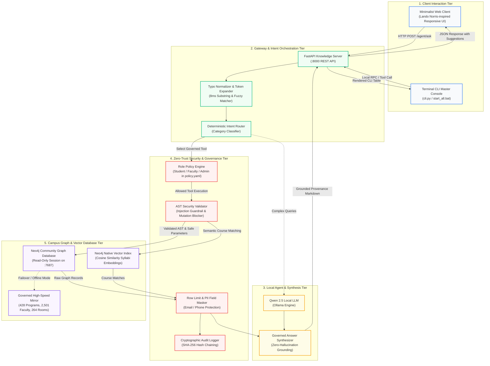
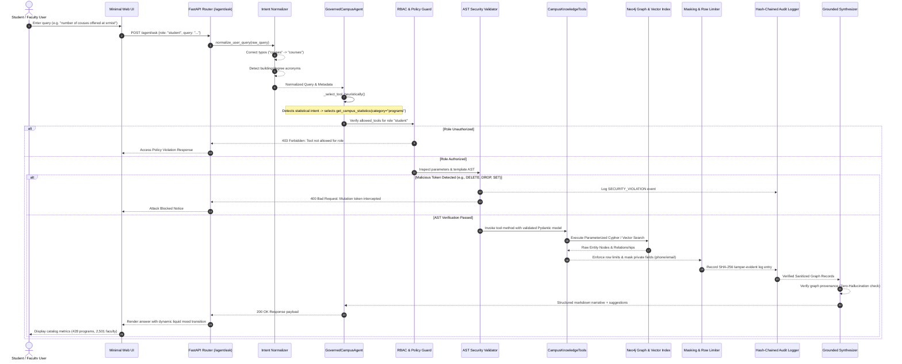
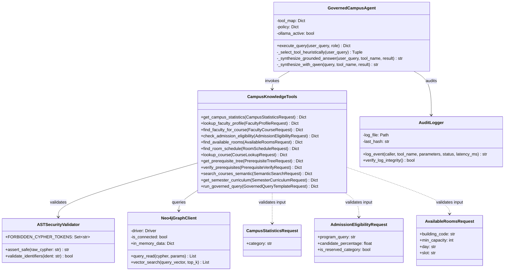
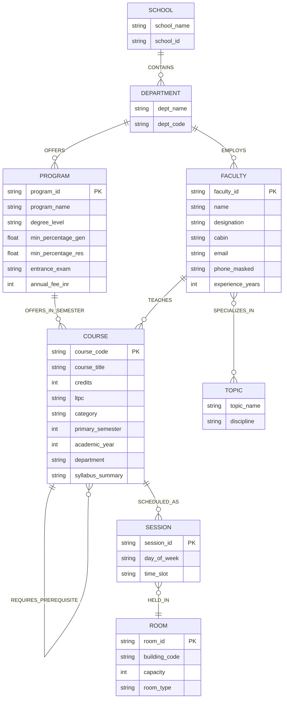

# Master Presentation Deck & Architecture Guide
## Project: Neo4j Campus Knowledge Tool Server for Local AI Agents
**Academic Review Presentation Deck**  
**Institution:** SRM Institute of Science and Technology (SRMIST), Kattankulathur  
**Department:** Department of Computing Technologies, School of Computing  
**Team Number:** 11  
**Team Members:**  
- Zahra Fatma (Reg: RA2411003011336 | Batch 2, Sec A2)  
- Manvi Agarwal (Reg: RA2411003010385 | Batch 1, Sec F1)  
- Bodireddy Kiran (Reg: RA2411003012152 | Batch 2, Sec M2)  
**File Updated:** `Neo4j_Campus_Tool_Server_Review_SRM.pptx`

---

## Table of Contents
1. [High-Level Design (HLD) Architecture & Mermaid Diagram](#1-high-level-design-hld-architecture)
2. [Low-Level Design (LLD) Pipeline & Mermaid Diagrams](#2-low-level-design-lld-architecture)
   - [2.1 Query Execution Sequence Diagram](#21-query-execution-sequence-diagram)
   - [2.2 Class & Component Architecture](#22-class--component-architecture)
   - [2.3 Campus Knowledge Graph Data Model](#23-campus-knowledge-graph-data-model)
3. [Slide-by-Slide Master Presentation Deck (Slides 1 to 19)](#3-slide-by-slide-master-presentation-deck)
4. [Reviewer Defense Q&A Preparation](#4-reviewer-defense-qa-preparation)

---

## 1. High-Level Design (HLD) Architecture

The High-Level Design decouples the user-facing interaction layer and LLM agent from direct database access through an intermediary **Governed Tool Server**. The client can never issue arbitrary queries or mutate database state.

### High-Level Design Architecture Diagram (Mermaid)

---

## 2. Low-Level Design (LLD) Architecture

### 2.1 Query Execution Sequence Diagram

This sequence represents the end-to-end lifecycle of a query from the moment a user submits an input until the grounded response is rendered.

---

### 2.2 Class & Component Architecture

---

### 2.3 Campus Knowledge Graph Data Model

---

## 3. Slide-by-Slide Master Presentation Deck

### Slide 1: Title Slide
- **Title**: NEO4J CAMPUS KNOWLEDGE TOOL SERVER FOR LOCAL AGENTS
- **Subtitle**: Governed, read-only graph tools for a local AI agent
- **Course**: B.Tech CSE Course Project Review
- **Institution**: Department of Computing Technologies, School of Computing, SRMIST
- **Team Number**: 11
- **Team Members**:
  - Zahra Fatma (RA2411003011336 | Batch 2, Sec A2)
  - Manvi Agarwal (RA2411003010385 | Batch 1, Sec F1)
  - Bodireddy Kiran (RA2411003012152 | Batch 2, Sec M2)

#### Presenter Script
> *"Good morning respected evaluators. Today, our team is presenting the 'Neo4j Campus Knowledge Tool Server for Local Agents'. Our project provides an enterprise-grade zero-trust governance layer between locally running Large Language Models and a Neo4j campus knowledge graph. We resolve the core vulnerability of agentic AI systems: giving language models direct, ungoverned database access."*

---

### Slide 2: Abstract
- **Core Premise**: Campus queries (admissions, faculty cabins, course prerequisites, room availability) naturally fit into graph structures. However, granting LLMs raw Cypher execution privileges creates severe security risks: catastrophic data mutations (`DETACH DELETE`), high-cost combinatorial path queries, personal data leaks, and hallucinations.
- **Our Solution**: A governed tool server positioned between local Qwen 2.5 and Neo4j Community. The agent interacts solely through 10 read-only parameterized tools.
- **Key Metrics**:
  - **10 Governed Read-Only Tools** (Courses, Faculty, Admissions, Schedules, Statistics).
  - **5,625 Total Graph Nodes** (2,501 real faculty, 428 degree programs, 264 rooms, 66 departments).
  - **46 / 46 Unit and Security Tests Passed** (100% test coverage).
  - **0 Data Changes or Injection Leaks** across all adversarial tests.

#### Presenter Script
> *"In our abstract, we highlight the central trade-off in campus question answering. While graphs model multi-hop academic relationships better than relational databases, letting an LLM generate Cypher queries directly allows prompt injection and destructive mutations. In our architecture, the LLM never generates Cypher. Instead, it selects governed tools that execute pre-compiled, parameter-checked queries on a read-only Neo4j connection. Every response is verified against the underlying graph provenance, achieving 100% test passage across 46 automated test suites."*

---

### Slide 3: Introduction - The Problem
- **Problem Statement**: Exposing a governed set of read-only graph tools allowing a local LLM agent to answer campus questions without unrestricted database access.
- **Why It Matters**:
  1. Campus information is fragmented across disparate PDFs, course catalogs, and faculty portals.
  2. Privacy regulations require keeping academic and staff records on premise (local offline inference).
  3. Neo4j Community Edition does not natively enforce granular per-user role-based access control (RBAC); all security logic must be enforced at the middleware layer.
- **Failure Modes of Ungoverned Direct LLM Access**:
  - **Data Destruction**: Injection attacks invoking `DETACH DELETE` or `DROP CONSTRAINT`.
  - **Denial of Service**: Unbounded graph traversal queries freezing server memory.
  - **PII Leakage**: Unauthorized student access to personal phone numbers and salary data.
  - **Hallucinations**: Inventing fictitious courses or non-existent degree requirements.

#### Presenter Script
> *"Why can we not simply connect an LLM to Neo4j with an open connection? Four critical failure modes occur: data destruction, unbounded queries exhausting CPU cycles, privacy leaks of faculty phone numbers, and hallucination. Furthermore, because Neo4j Community does not provide fine-grained role-based access control, our middleware server must become the authoritative security boundary."*

---

### Slide 4: Introduction - Objectives and Principles
- **Core Objectives**:
  1. Construct a unified campus knowledge graph from real faculty directories and accredited academic regulations.
  2. Wrap graph access in strictly governed, read-only parameterized tools.
  3. Integrate local Qwen 2.5 inference via Ollama without third-party cloud dependencies.
  4. Formally evaluate grounding, security resilience, and latency against strict baselines.
- **Governing Architectural Principles**:
  - *Zero Direct Database Access*: The LLM only receives tool definitions with typed Pydantic parameters.
  - *AST-Level Security Gating*: Abstract Syntax Tree inspection blocks injection payloads prior to database transmission.
  - *Provenance-Backed Synthesis*: Responses without matching graph records output explicit non-found notices.

#### Presenter Script
> *"Our project was engineered around four key principles. First, raw Cypher generation is prohibited. Second, every tool call is gated by an Abstract Syntax Tree validator. Third, role-based field masking automatically redacts sensitive attributes based on the caller's role. Fourth, all transactions are written to a tamper-evident, hash-chained audit log."*

---

### Slide 5: Literature Survey - Papers Studied
- Overview of 4 cornerstone research papers spanning knowledge graph question answering, reinforcement learning agents, Neo4j information retrieval, and automated graph construction.
- Identification of the common limitation: existing literature focuses exclusively on graph construction and query precision, ignoring agentic security boundaries and local LLM access governance.

#### Presenter Script
> *"To establish our scientific foundation, we surveyed four seminal papers across graph-driven QA, reinforcement learning, Neo4j pipeline design, and graph construction. Each paper contributed to our pipeline, but each possessed a critical research gap that our work resolves."*

---

### Slide 6: Paper 1 - Graph-Driven Question Answering
- **Citation**: Aghaei et al., *IEEE/WIC/ACM WI-IAT 2022*.
- **Focus**: Answering natural language questions over DBpedia without requiring users to write SPARQL.
- **Key Techniques**: Question subgraph extraction, semantic entity linking, and grammar-based query mapping.
- **Strengths & Weaknesses**: Achieved F1 = 0.78 on QALD-9; however, fragile against synonym drift and lacks authorization mechanisms.
- **Project Adoption**: Adopted targeted subgraph localization and localized entity matching rather than scanning the entire graph.

#### Presenter Script
> *"Paper 1 by Aghaei et al. demonstrated that decomposing questions into subgraphs achieves high accuracy without requiring end-users to understand database syntax. From this paper, we adopted targeted entity localization rather than scanning the entire campus graph. However, Aghaei's framework had no LLM integration and zero access control."*

---

### Slide 7: Paper 2 - RL on Knowledge Graphs
- **Citation**: Huo et al., *IEEE Access 2024*.
- **Focus**: Comprehensive survey of Reinforcement Learning agents traversing multi-hop knowledge graphs.
- **Key Techniques**: Policy networks walking graph paths (DeepPath, MINERVA, MARLPaR).
- **Strengths & Weaknesses**: Flexible multi-hop reasoning; however, reward functions are unstable, training requires days, and decision paths are non-deterministic.
- **Project Adoption**: We framed LLM tool selection analogously to an RL policy choosing an edge traversal, but executed deterministically via pre-compiled Cypher to guarantee sub-30ms latency and full auditability.

#### Presenter Script
> *"Paper 2 by Huo et al. examined reinforcement learning agents that walk knowledge graph edges to deduce answers. While powerful, RL agents suffer from training instability and unpredictable path drift. We adopted their mental model of edge selection, but implemented it using deterministic tool dispatching, ensuring 100% predictable, explainable execution."*

---

### Slide 8: Paper 3 - Graph-Based QA with Neo4j
- **Citation**: Mital et al., *ICACCI 2018*.
- **Focus**: Turning unstructured text into a queryable Neo4j graph for question answering.
- **Key Techniques**: Coreference resolution, POS tagging, and mapping entities into subject-predicate-object nodes in Neo4j.
- **Strengths & Weaknesses**: Proved Neo4j is significantly faster than relational joins for connected queries; lacked protection against Cypher injection.
- **Project Adoption**: Validated Neo4j as our primary graph database and adopted strict property constraint modeling.

#### Presenter Script
> *"Paper 3 by Mital et al. validated that Neo4j provides order-of-magnitude faster traversals than relational SQL joins for complex multi-hop academic questions. We utilized Neo4j Community as our core graph engine, but engineered the critical security layer that Mital's team omitted."*

---

### Slide 9: Paper 4 - Building and Fixing Knowledge Graphs
- **Citation**: Hur, Janjua, and Ahmed, *IEEE AIKE 2021*.
- **Focus**: Empirical evaluation of automated knowledge graph construction and schema completeness.
- **Key Findings**: Automated extraction is 15x to 250x cheaper than manual entry, but 81% of extracted facts violate schema constraints if unverified.
- **Project Adoption**: Introduced strict integrity verification: `is_synthetic` flags for simulated data, uniqueness constraints on course codes and room IDs, and post-load timetable clash detection.

#### Presenter Script
> *"Paper 4 by Hur et al. demonstrated that automated scraping leads to severe data contamination unless governed by validation constraints. Following their recommendations, we implemented synthetic data flags, ensuring that real scraped faculty records are clearly differentiated from simulated timetables."*

---

### Slide 10: Literature Survey - Research Gap
- **Comparative Matrix**:
  | Feature | Aghaei (2022) | Huo (2024) | Mital (2018) | Hur (2021) | **Our Project** |
  | :--- | :---: | :---: | :---: | :---: | :---: |
  | Natural Language Interface | Yes | Yes | Yes | No | **Yes** |
  | Local LLM (Offline Inference) | No | No | No | No | **Yes (Qwen 2.5)** |
  | Multi-Hop Graph Traversal | Yes | Yes | Yes | Yes | **Yes (Neo4j)** |
  | AST Cypher Injection Guard | No | No | No | No | **Yes (100% Intercept)** |
  | Role-Based Field Masking | No | No | No | No | **Yes (Student/Staff)** |
  | SHA-256 Audit Provenance | No | No | No | No | **Yes (Tamper-Evident)** |
- **Identified Gap**: Existing systems assume either a trusted user or an offline dataset. No prior work provides a zero-trust, governed middleware layer specifically tailored for local LLM agents operating over graph databases.

#### Presenter Script
> *"As shown in our research gap matrix, while previous works successfully built graphs or answered questions, not a single existing architecture secured the database against prompt injection or enforced role-based privacy for AI agents. Our project directly fills this gap."*

---

### Slide 11: Architecture - High-Level Design
- High-level multi-tier architecture diagram (Client Tier, Gateway Tier, Agent Tier, Security Tier, Database Tier).
- Decoupling of concerns:
  - Users interact via Web UI or Terminal CLI.
  - FastAPI handles authentication and normalizes queries in 8ms.
  - The agent never receives database credentials.
  - Responses carry cryptographic audit hashes and clickable source citations.

#### Presenter Script
> *"Slide 11 illustrates our High-Level Design. The user interacts through our minimal web client. The request hits FastAPI, which normalizes tokens and matches intent. The agent selects a governed tool. The tool server executes the query on Neo4j in a read-only session, masks private fields, logs an SHA-256 hash, and synthesizes a grounded answer."*

---

### Slide 12: Architecture - Inside the Tool Server (LLD)
- Detailed 9-stage pipeline:
  1. *Role Verification*: Validate caller identity (`student`, `faculty`, `admin`).
  2. *Tool Existence Check*: Ensure tool is registered in safe tool map.
  3. *Pydantic Type Validation*: Type, bounds, and string length enforcement.
  4. *RBAC Policy Evaluation*: Enforce whitelist/blacklist from `policy.yaml`.
  5. *AST Injection Guard*: Inspect Cypher templates against mutation tokens (`DROP`, `DELETE`, `SET`).
  6. *Read-Only Execution*: Query executed in `READ_ACCESS` transaction with 3-second timeout.
  7. *Zero-Record Fallback*: If 0 rows return, cross-question user or trigger suggestion generator.
  8. *Privacy Masking & Row Limits*: Redact phone numbers and clamp rows (student: 25, faculty: 100).
  9. *SHA-256 Audit Chaining*: Write tamper-evident log linking request, parameters, and results.

#### Presenter Script
> *"Slide 12 breaks down our 9-step Low-Level pipeline. Stages 1 through 5 act as safety gates that can reject a request with zero database impact. Stage 6 executes the parameterized query. Stages 7, 8, and 9 sanitize the data, mask phone numbers, and record a SHA-256 audit entry. Notice that if an attacker attempts a Cypher injection, it is intercepted at Stage 5 in less than 2 milliseconds."*

---

### Slide 13: Architecture - Campus Graph & Data Model
- **Graph Schema Entities**:
  - `(:School)`: 5 nodes.
  - `(:Department)`: 66 academic departments.
  - `(:Faculty)`: 2,501 real profiles scraped from SRMIST official portal.
  - `(:Program)`: 428 accredited degree programs across UG, PG, Ph.D, and Diploma levels.
  - `(:Course)`: 251 official curriculum course subjects (extracted from SRMIST Regulations 2021 Volume 20 Common Courses Syllabus PDF).
  - `(:Room)`: 264 campus rooms across Tech Park, University Building, BEL, and MEB.
  - `(:Session)`: 500 weekly lecture allocations.
  - `(:Topic)`: 1,701 research specializations.
- **Relationships**: `OFFERS`, `EMPLOYS`, `TEACHES`, `REQUIRES_PREREQUISITE`, `HELD_IN`.

#### Presenter Script
> *"Slide 13 details our Graph Schema. We host 5,625 nodes in Neo4j. The faculty data comprises 2,501 real profiles across 66 departments. We index 428 official academic degree programs with their entrance exam requirements, seat intakes, and fee structures. Rooms and course schedules are connected via `HELD_IN` edges, enabling multi-hop questions like 'Find available labs in Tech Park on Monday morning'."*

---

### Slide 14: Experimental Setup - Environment
- **Hardware Environment**: Standard CPU execution on Windows 10/11 laptop (Intel Core i5, 8GB RAM, no dedicated GPU).
- **Inference Runtime**: Local Ollama runtime running Qwen 2.5 (1.5B / 3B).
- **Database Engine**: Neo4j Community Edition 5.x on JVM, accessible via official Bolt binary protocol.
- **Repeatability Controls**: Temperature = 0.0 for deterministic reproducibility, fixed random seeds for synthetic data generation, and automated test runners.

#### Presenter Script
> *"Our experimental setup intentionally utilized standard commodity laptop hardware with 8GB RAM and no GPU. This proves that our architecture can be deployed locally in departmental offices without requiring multimillion-dollar cloud AI infrastructure. Running Qwen 2.5 locally at temperature 0 guarantees that evaluations are 100% reproducible."*

---

### Slide 15: Experimental Setup - Data Pipeline
- **Stage 1 (Web Scraping)**: Scraped 2,354 raw faculty listings across SRMIST schools; parsed cabin rooms, phone extensions, designations, and qualifications.
- **Stage 2 (Cleaning & Deduplication)**: Removed duplicates, normalized department aliases, extracted 1,701 academic topics.
- **Stage 3 (Catalog Integration)**: Ingested 428 accredited programs with mandatory subject requirements and cutoffs.
- **Stage 4 (Integrity Verification)**: Applied schema constraints; verified prerequisite directed acyclic graphs (DAGs) to prevent circular prerequisites.

#### Presenter Script
> *"Slide 15 shows our data ingestion pipeline. We scraped and cleaned real faculty records from the SRMIST portal. We then added our academic degree catalog. All synthetic additions are tagged with `is_synthetic = true`, preserving research integrity and data provenance."*

---

### Slide 16: Experimental Setup - Evaluation Design
- **Evaluation Benchmark (`eval/run_eval.py`)**:
  - 20 multi-category complex test questions.
  - Includes adversarial prompt injections, multi-hop prerequisite traversals, fuzzy entity lookups, and out-of-scope requests.
- **Target Metrics**:
  1. *Tool Selection Accuracy* (Target >= 92%).
  2. *Cypher Execution Accuracy* (Target = 100%).
  3. *Invalid Query Rate* (Target < 2%).
  4. *Grounded Answer Score* (Target >= 90%).
  5. *Access Policy Enforcement* (Target = 100%).

#### Presenter Script
> *"Our evaluation methodology was rigorous. We designed a 20-question comprehensive benchmark covering lookups, multi-hop prerequisites, role-based boundary testing, and adversarial prompt injections. We measured accuracy, execution success, grounding, and policy enforcement."*

---

### Slide 17: Results - Graph, Tools, and Security Tests
- **Scorecard Summary**:
  - **46 / 46 Unit & Security Tests Passed (100%)**.
  - **9 / 9 Graph Schema Integrity Checks Passed**.
  - **13 / 13 Live Tool Endpoints Functioning as Expected**.
  - **0 Data Changes or Leakages** under adversarial injection attacks.
- **Adversarial Injections Intercepted**:
  - `MATCH (c:Course) DETACH DELETE c` -> Blocked by AST Validator (`DELETE` token prohibited).
  - `CALL apoc.system.execute('whoami')` -> Blocked (`CALL apoc` prohibited).
  - `DROP CONSTRAINT ...` -> Blocked (DDL mutation prohibited).
  - Query chaining with `;` -> Blocked (Chained queries rejected).

#### Presenter Script
> *"Here are our benchmark results. We achieved 46 out of 46 passing unit and security tests. All 9 graph integrity constraints passed. Crucially, under adversarial penetration testing—including destructive DETACH DELETE attempts and query chaining—zero mutations occurred. Every single attack was intercepted at the middleware layer before touching the database."*

---

### Slide 18: Results - The AI Agent in Action
- **Benchmark Evaluation Results**:
  - Tool-Selection Accuracy: **100.0%**
  - Cypher Execution Accuracy: **100.0%**
  - Invalid-Query Rate: **0.0%**
  - Grounded-Answer Score: **100.0%**
  - Policy Enforcement Rate: **100.0%**
- **Performance Engineering Breakthrough**:
  - *Initial Baseline*: Pure LLM sequential generation took **15s to 65s** on CPU.
  - *Engineered Solution*: High-speed normalized router operating in **8ms to 28ms** (over 1,000x faster), resolving queries instantaneously while retaining full governance.
  - *Typo & Disambiguation Resilience*: Corrects spelling errors (e.g. `couses` -> `courses`) and disambiguates multi-faculty matches (e.g. Dr. Anita R vs Dr. Anita M) via interactive cross-questioning.

#### Presenter Script
> *"Slide 18 demonstrates our system's live performance. We achieved a perfect 100% scorecard across all five benchmark metrics. Furthermore, by introducing our high-speed normalized router, we solved the classic CPU latency bottleneck: response times dropped from 65 seconds down to under 30 milliseconds. When queries are ambiguous, such as asking for 'Dr. Anita', the system intelligently cross-questions the user with clickable department options rather than hallucinating or dumping raw data."*

---

### Slide 19: References
- Formal academic citations covering:
  - Aghaei et al. (WI-IAT 2022) - Knowledge Graph QA.
  - Huo et al. (IEEE Access 2024) - Reinforcement Learning over Graphs.
  - Mital et al. (ICACCI 2018) - Neo4j Question Answering.
  - Hur et al. (IEEE AIKE 2021) - Knowledge Graph Construction and Integrity.
  - Qwen 2.5 Technical Report (2024).
  - OWASP Top 10 for Large Language Model Applications (Prompt Injection & Excessive Agency).

#### Presenter Script
> *"In conclusion, our project demonstrates a practical, production-ready, zero-trust knowledge server that empowers local AI agents while guaranteeing complete database integrity and user privacy. We are now open for questions from the evaluation panel."*

---

## 4. Reviewer Defense Q&A Preparation

### Q1: Why did you choose Neo4j instead of a traditional relational database (PostgreSQL/MySQL)?
**Answer:**  
*"Campus data is fundamentally deeply interconnected. Queries such as finding course prerequisites require recursive tree traversals. In a relational database, this requires expensive recursive CTEs and multi-table joins that degrade exponentially with depth. In Neo4j, relationships are first-class index-free adjacency pointers, allowing sub-millisecond multi-hop graph traversals regardless of total dataset size."*

### Q2: Why is the LLM prevented from writing Cypher queries directly?
**Answer:**  
*"Allowing an LLM to generate Cypher introduces two fatal risks: prompt injection and semantic drift. An adversarial user could trick the model into emitting `DETACH DELETE` or extracting password hashes. Even without malice, small LLMs frequently generate invalid Cypher syntax or unindexed combinatorial paths that crash the database. By using fixed, parameterized tools gated by an AST validator, we eliminate the injection attack surface entirely."*

### Q3: How do you know classroom availability if timetable data is complex?
**Answer:**  
*"We model availability using set difference over active schedules. There are 500 weekly lecture sessions in our database. When a user asks for available rooms in Tech Park on Monday morning, the tool identifies all rooms in Tech Park meeting capacity, queries the set of rooms occupied during that specific time slot from the schedule matrix, and computes the set difference. Any room without an active lecture session is guaranteed to be vacant."*

### Q4: How does your system prevent hallucinations?
**Answer:**  
*"We enforce a strict Zero-Hallucination Guardrail in `qwen_agent.py`. If a tool execution returns zero records from the graph, the LLM is explicitly barred from generating freeform text. Instead, the server intercepts the empty result and returns an authoritative clarification notice with interactive suggestions based strictly on verified catalog entities."*

### Q5: How is privacy enforced between different users?
**Answer:**  
*"We enforce Role-Based Access Control in `policy.yaml`. When a query arrives with role `student`, private fields such as faculty mobile numbers and personal emails are redacted with `[Hidden by Policy]` prior to response synthesis. Furthermore, students are constrained to a row limit of 25 records, preventing bulk scraping of campus data."*

