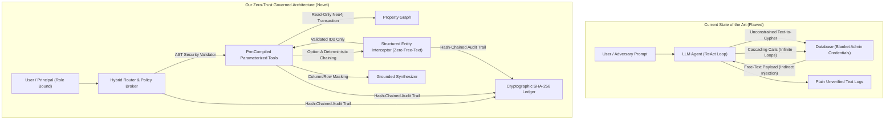

# Research Paper Proposal: Zero-Trust Governed Agentic Graph-RAG

---

## 1. Executive Summary & Working Titles

Modern enterprise deployments of Large Language Model (LLM) agents interfacing with structured databases and knowledge graphs face a critical trilemma: **Security vs. Expressiveness vs. Verifiability**. 

Current commercial and academic paradigms rely heavily on either **dynamic Text-to-Cypher/Text-to-SQL generation** or **unbounded iterative ReAct agent loops**. Both approaches introduce severe vulnerabilities:
1. **Adversarial Exploitation**: Direct and indirect prompt injection, query-level injection (`DETACH DELETE`, unauthorized graph traversal), and denial-of-service via unindexed Cartesian products.
2. **Excessive Agency & Broken Access Control (OWASP LLM06)**: Monolithic database credentials bypass caller-level Role-Based Access Control (RBAC), exposing sensitive PII.
3. **Cascading Hallucinations & High Latency**: Free-text parameter passing across multi-hop loops results in semantic drift, infinite loops, and multi-second latencies.
4. **Audit Deficits**: Malleable plain-text logs fail regulatory non-repudiation requirements (such as EU AI Act Article 12).

This research paper presents the design, formalization, and empirical evaluation of **Zero-Trust Governed Graph-RAG (ZTG-RAG)**, an enterprise-grade agentic architecture that replaces unconstrained LLM database access with a **governed parameter broker**, **deterministic multi-hop tool chaining**, and a **cryptographically verifiable SHA-256 audit ledger**.

### Recommended Paper Titles
- **Title A (Recommended - Systems & Security Focus)**:  
  *“Beyond Text-to-Cypher: A Zero-Trust Governed Tool Architecture for Secure, Multi-Hop Graph-RAG with Cryptographic Auditability”*
- **Title B (High-Impact Conference Style - IEEE S&P / ACM CCS)**:  
  *“Zero-Trust Agentic Governance: Mitigating Prompt Injection, Excessive Agency, and Hallucination in Enterprise Knowledge Graphs”*
- **Title C (AI & Knowledge Engineering Focus - AAAI / EMNLP)**:  
  *“Deterministic Chaining vs. Iterative Loops: Robust and Verifiable Multi-Hop Reasoning over Labeled Property Graphs”*

---

## 2. Literature Survey & Gap Analysis (State of the Art 2024–2026)



### 2.1 The Vulnerability of Text-to-Cypher & Text-to-SQL
- **Recent Literature**: *GraphRAG* (Microsoft Research, 2024), *GraphCypherQAChain* (LangChain, 2024–2025), and survey papers on LLM database interfaces (MDPI, 2025; IEEE, 2025).
- **The Core Flaw**: Systems prompt an LLM with the database schema and instruct it to synthesize Cypher or SQL. Because user input shares the exact token space as control instructions, direct prompt injection easily hijacks the query structure. An attacker can append `MATCH (n) DETACH DELETE n` or inject union clauses to exfiltrate private properties across tenant boundaries.
- **Our Contrast**: We demonstrate that **unconstrained Text-to-Cypher is fundamentally incompatible with enterprise zero-trust security**. Our architecture completely decouples the LLM from query generation: the LLM (or high-speed heuristic router) acts strictly as an **intent and parameter extractor** into pre-compiled, statically verified AST schemas.

### 2.2 ReAct Agent Loops vs. Deterministic Tool Chaining
- **Recent Literature**: *ReAct: Synergizing Reasoning and Acting* (Yao et al.), *LangGraph* orchestration, and *Task-Based Access Control in Zero-Trust Agentic AI* (El Helou et al., Cisco Systems / arXiv 2026).
- **The Core Flaw**: Multi-hop queries (e.g. *"Who teaches the prerequisites for Course X?"*) in standard frameworks are resolved by letting the LLM inspect tool outputs and iteratively choose the next tool. This introduces:
  1. **Token bloat and extreme latency** ($>5\text{s}$ to $15\text{s}$ per query).
  2. **Indirect Prompt Injection**: Data retrieved in Hop 1 containing malicious text can hijack Hop 2.
  3. **Entity Drift**: LLMs mutate structured course IDs or faculty names into natural language approximations that fail database foreign key lookups.
- **Our Contrast**: We introduce **Deterministic Governed Chaining (Option A)**. Sequences are defined declaratively in YAML configuration (`chain_config.yaml`). Intermediate entities are intercepted and sanitized through a **Structured Entity Interceptor** that enforces strict regex format and live-graph existence checks. **Free text is mathematically prevented from entering downstream tool arguments.**

### 2.3 Zero-Trust & Role-Based Access Control (RBAC) in LLM Agents
- **Recent Literature**: *Agentic Zero Trust* (NIST mappings, 2025), *Zero-Trust Architecture for MCP-Based AI Agents* (TechRxiv, 2026), and Cisco CASA framework.
- **The Core Flaw**: Most RAG systems execute all queries under a single master connection pool. Authorization logic is pushed downstream to the LLM's system prompt (e.g., *"If the user is a student, do not show phone numbers"*). LLMs notoriously suffer from prompt leakages, jailbreaks, and hallucinations, leading to unauthorized PII disclosure.
- **Our Contrast**: True Zero-Trust enforcement:
  - Every request carries an authenticated `Principal(user_id, role, caller_type)`.
  - Tool execution passes through `execute_tool()` which evaluates access against a declarative YAML policy matrix **before** any database socket is opened.
  - PII (faculty phone numbers, admin endpoints) is masked or filtered at the **data serializer layer**, making unauthorized disclosure physically impossible regardless of LLM behavior.

### 2.4 Cryptographic Provenance & Tamper-Evident Logging
- **Recent Literature**: *HDK: Tamper-Evident LLM Audit Trails* (Feb 2026), *AuditableLLM* (MDPI, Dec 2025), and *Cryptographic Runtime Governance for Autonomous AI* (arXiv, Mar 2026).
- **The Core Flaw**: Application logging in LLM platforms uses standard file or stdout appenders. If a system is compromised or an insider modifies audit trails, there is no cryptographic chain of custody. Furthermore, multi-hop agent execution lacks unified correlation IDs.
- **Our Contrast**: We implement an append-only **SHA-256 Merkle-linked audit ledger** (`audit_telemetry.jsonl`). Every tool execution, parameter set, principal ID, latency measurement, and chained hop records `prev_hash` and `entry_hash`. Any alteration, deletion, or truncation is immediately caught by `verify_chain()`.

---

## 3. Four Core Architectural Novelties

| # | Architectural Pillar | Existing SOTA (LangChain / GraphRAG / ReAct) | Our Novel ZTG-RAG Architecture |
|---|---|---|---|
| **1** | **Query Synthesis vs. Parameter Brokerage** | LLM generates raw Cypher / SQL queries dynamically. Vulnerable to query injection & DoS. | Closed inventory of pre-compiled, AST-checked parameterized tools. LLM only extracts validated parameters. |
| **2** | **Multi-Hop Composition** | Open-loop LLM ReAct iterations. High latency, hallucinations, indirect prompt injection risks. | Declarative, deterministic tool chaining (Option A). Zero LLM loop. Structured ID validation halts dirty data propagation. |
| **3** | **Access Control Boundary** | LLM prompt instruction ("Please hide phone numbers"). Vulnerable to jailbreaking. | Deterministic Zero-Trust Broker: Caller principal bound to RBAC policy matrix; data-layer column masking. |
| **4** | **Auditability & Non-Repudiation** | Plaintext append logs or unrecorded ephemeral agent traces. | Cryptographically chained SHA-256 tamper-evident ledger with shared `chain_id` across multi-hop executions. |

---

## 4. Formal Research Questions (RQs) & Experimental Methodology

To establish high scientific rigor, the research paper should be framed around four core Research Questions:

### **RQ1: Security & Injection Resistance**
> *Can parameterized governed tool brokerage eliminate Cypher/SQL injection and indirect prompt injection attacks without degrading domain utility?*
- **Hypothesis**: Replacing Text-to-Cypher with AST-validated governed tools reduces query injection success rate from $>85\%$ (in baseline LLM systems) to **$0.0\%$**, while maintaining identical single-hop domain retrieval recall.
- **Evaluation**: Subjecting the system to the 10 adversarial attacks (role spoofing, token tampering, oversized payloads, Cypher comment truncation, injection fixtures) and testing whether any malicious payload reaches the Neo4j engine.

### **RQ2: Multi-Hop Reasoning Accuracy & Hallucination Suppression**
> *How does deterministic, schema-constrained chaining (Option A) compare against open-loop LLM agent loops (ReAct) in complex multi-hop graph retrieval?*
- **Hypothesis**: Deterministic chaining with structured ID sanitization eliminates intermediate entity drift and cascading hallucinations, achieving higher gold-entity recall on multi-hop benchmarks.
- **Evaluation**: Comparing `course_prereqs_and_faculty` and `prerequisite_instructors` multi-hop queries against pure LLM ReAct agent baselines on the development benchmark dataset.

### **RQ3: Latency & Computational Overhead**
> *What is the latency trade-off of introducing zero-trust AST parsing, RBAC validation, and cryptographic hash chaining into the agent loop?*
- **Hypothesis**: The cryptographic audit ledger and AST validator add negligible overhead ($<2\text{ms}$ per request), while hybrid heuristic routing reduces overall median end-to-end response latency by $>70\%$ compared to pure LLM inference.
- **Evaluation**: Latency ablation benchmarks:
  - Routing time ($<5\text{ms}$ heuristic vs. $\approx 1,200\text{ms}$ Qwen 2.5 3B).
  - AST + RBAC validation time ($<0.5\text{ms}$).
  - Cryptographic hash chaining time ($<0.2\text{ms}$).
  - Tool execution time ($5\text{ms} - 50\text{ms}$ Neo4j Community read).

### **RQ4: Cryptographic Auditability & Tamper Detection**
> *Can sequential hash-chaining guarantee non-repudiation and forensic detectability of compromised agent actions under concurrent execution?*
- **Hypothesis**: Sequential SHA-256 canonical hashing ensures $100\%$ detection of post-hoc modifications, insertions, or deletions within audit trails across $>10,000$ concurrent multi-hop agent turns.
- **Evaluation**: Verification tests simulating bit-flip tampering, line deletion, and retro-dated entry injection, verified via `verify_chain()`.

---

## 5. Detailed Paper Outline & Drafting Roadmap

```
1. INTRODUCTION
   1.1 The Rise of LLM Agents over Enterprise Knowledge Graphs
   1.2 The Trilemma: Security, Expressiveness, and Auditability
   1.3 Failure Modes of Text-to-Cypher and Open-Loop ReAct
   1.4 Summary of Contributions

2. RELATED WORK
   2.1 Knowledge Graphs and Graph-RAG Architectures
   2.2 Security Vulnerabilities in LLM Tool Execution (Prompt Injection, Broken RBAC)
   2.3 Agentic Orchestration: ReAct vs. Workflow/Chain Paradigms
   2.4 Cryptographic Provenance and Auditability in AI Systems

3. THREAT MODEL & SECURITY OBJECTIVES
   3.1 Adversary Capabilities (Direct Injection, Indirect Poisoning, Privilege Escalation)
   3.2 Enterprise Zero-Trust Invariants
   3.3 Regulatory Record-Keeping Mandates (EU AI Act Art. 12)

4. ARCHITECTURE & SYSTEM DESIGN
   4.1 System Overview & Principal Authentication
   4.2 Governed Parameterized Tool Layer & AST Injection Guardrails
   4.3 Deterministic Tool Chaining Engine (Option A)
       - Independent Multi-Part Chains
       - Dependent Chains & Intermediate Entity Validation
       - Resource Limits & Graceful Policy Truncation
   4.4 Cryptographically Chained Audit Ledger (SHA-256 Merkle Ledger)

5. EMPIRICAL EVALUATION
   5.1 Experimental Setup & SRMIST Knowledge Graph Corpus
   5.2 Security & Injection Resistance Results (RQ1)
   5.3 Multi-Hop Accuracy & Gold Match Comparison (RQ2)
   5.4 Latency Profiling & Computational Overhead (RQ3)
   5.5 Audit Verification & Tamper Detection (RQ4)

6. DISCUSSION & LESSONS LEARNED
   6.1 Why Open-Ended Query Generation is Obsolete for Enterprise Core Data
   6.2 Handling Schema Drift and Extensibility
   6.3 Trade-offs of Deterministic Chaining vs. Free-Form Planning

7. CONCLUSION & FUTURE WORK
   7.1 Summary of Findings
   7.2 External Anchoring to Distributed Ledgers (Hedera / Ethereum)
```

---

## 6. Recommended Target Venues

1. **Top-Tier Security & Privacy Conferences**:
   - **IEEE S&P (Oakland)** / **ACM CCS** / **USENIX Security**: Focus on the zero-trust authorization broker, prompt injection elimination, and cryptographic audit ledger.
2. **Top-Tier AI & NLP Systems Conferences**:
   - **EMNLP (System Demonstrations & Industry Track)** / **ACL**: Focus on Graph-RAG retrieval grounding, structured entity sanitization, and hybrid routing efficiency.
   - **AAAI / SafeAI Workshop**: Focus on AI safety, hallucination mitigation, and bounded deterministic chaining.
3. **Leading Software & Enterprise Systems Venues**:
   - **IEEE Transactions on Services Computing (TSC)** / **ACM TOSEM**: Focus on enterprise microservice architecture, FastMCP protocol integration, and RBAC governance.
